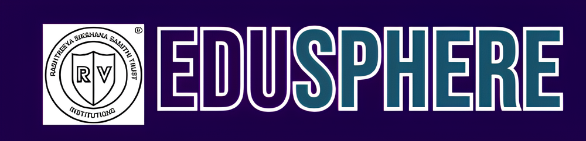
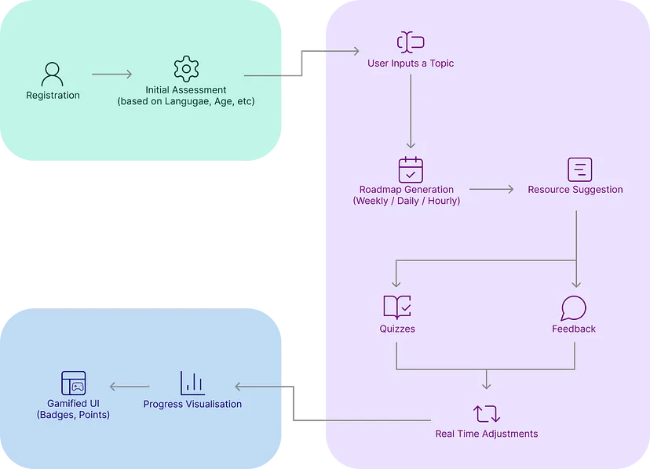
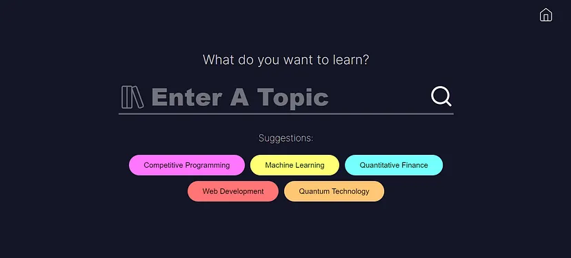
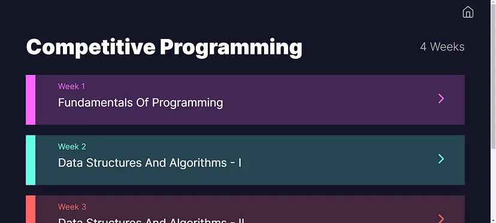
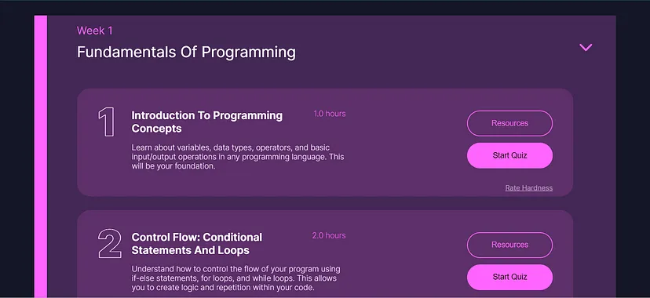

# 🎓 Edusphere – AI-Powered Personalized Learning Platform

<p align="center">
  
</p>

<p align="center">
  
</p>

<h3 align="center">🚀 Transforming Education Through Artificial Intelligence</h3>

<p align="center">
  Personalized Learning Roadmaps • AI-Generated Quizzes • Smart Learning Resources
</p>

<p align="center">
  
  
  
  
</p>

<p align="center">
  
  
  
</p>

---

## 📌 About the Project

**Edusphere** is an AI-powered personalized learning platform designed to make education more structured, interactive, and accessible.

Traditional learning approaches often provide the same learning materials to everyone, regardless of their knowledge level, learning speed, or available study time.

Edusphere addresses this challenge by leveraging Generative AI to create personalized learning experiences.

Users can select a topic, specify their current knowledge level, and choose their preferred learning duration. Based on these inputs, the platform generates a customized learning roadmap, provides AI-generated learning resources, and creates quizzes to evaluate their understanding.

## ✨ Key Features

### 🗺️ 1. Personalized Learning Roadmaps
- Generate customized learning roadmaps based on user requirements.
- Select a learning topic and knowledge level.
- Specify the available learning duration.
- Break complex subjects into manageable topics and subtopics.
- Receive estimated completion times for individual subtopics.

### 🤖 2. AI-Generated Learning Resources
- Generate learning materials using Google Gemini AI.
- Receive explanations based on the selected topic.
- Customize learning content according to knowledge level and available time.

### 📝 3. Intelligent Quiz Generation
- Automatically generate multiple-choice questions.
- Evaluate understanding of individual subtopics.
- Display correct answers and explanations.
- Generate questions based on the selected course and learning content.

### 📊 4. Learning Progress Tracking
- Track completed learning activities.
- Monitor quiz performance.
- Maintain learning statistics.
- Display performance information through charts.

### 👤 5. User Profile and Dashboard
- View saved learning topics.
- Access previously generated roadmaps.
- Review learning statistics.
- Monitor learning performance.

### 🌐 6. Translation Support
- Includes a translation utility and a backend translation endpoint intended to support multilingual learning.

---

## 🛠️ Technology Stack

### 🎨 Frontend Development

<p align="left">
  
</p>

| Technology | Purpose |
|---|---|
| React.js | Building interactive user interfaces |
| JavaScript | Application logic |
| HTML5 | Web page structure |
| CSS3 | Styling and responsive layouts |
| Axios | API communication |
| React Router DOM | Application navigation |
| Chart.js | Data visualization |
| React Markdown | Rendering formatted learning content |
| Lucide React | Icons and interface elements |

### ⚙️ Backend Development

<p align="left">
  
</p>

| Technology | Purpose |
|---|---|
| Python | Backend programming |
| Flask | REST API development |
| Flask-CORS | Cross-origin resource sharing |
| Python-dotenv | Environment variable management |

### 🧠 Artificial Intelligence

<p align="left">
  
</p>

| Technology | Purpose |
|---|---|
| Google Gemini API | Generative AI integration |
| Gemini 2.0 Flash | Roadmap, quiz, and resource generation |
| Generative AI | Personalized educational content |

### 💾 Data Storage

<p align="left">
  
</p>

- Browser Local Storage
- Stores topics, roadmaps, quizzes, and learning statistics locally.

### 🔧 Development Tools

<p align="left">
  
</p>

- Visual Studio Code
- Git
- GitHub
- npm

---

## 🏗️ Project Architecture

```text
Edusphere/
│
├── backend/
│   ├── base.py
│   ├── roadmap.py
│   ├── quiz.py
│   ├── generativeResources.py
│   ├── requirements.txt
│   └── .flaskenv
│
├── public/
│   ├── logo.png
│   ├── avatar.jpg
│   ├── hackathon_banner.png
│   ├── image.png
│   ├── image-1.png
│   ├── image-2.png
│   └── process_flow.png
│
├── src/
│   ├── components/
│   │   ├── header/
│   │   ├── loader/
│   │   └── modal/
│   │
│   ├── pages/
│   │   ├── input/
│   │   ├── profile/
│   │   ├── quiz/
│   │   └── roadmap/
│   │
│   ├── translate/
│   │   └── translate.js
│   │
│   ├── App.js
│   ├── App.css
│   ├── index.js
│   └── index.css
│
├── package.json
├── package-lock.json
└── README.md
```

---

## 🔄 How Edusphere Works

<p align="center">
  
</p>

1. **User Input:** The learner enters a topic, knowledge level, and preferred learning duration.

2. **Frontend Processing:** React collects the information and sends an API request to the Flask backend using Axios.

3. **AI Processing:** The backend communicates with Google Gemini AI.

4. **Roadmap Generation:** Gemini generates a personalized learning roadmap with topics, subtopics, descriptions, and estimated durations.

5. **Learning Resources:** Users can generate educational content for their selected learning topics.

6. **Quiz Generation:** The platform generates multiple-choice questions to evaluate the learner's understanding.

7. **Progress Tracking:** Quiz results and learning information are maintained using browser Local Storage.

8. **Dashboard:** Users can review their saved roadmaps and learning statistics.

---

## 📸 Project Screenshots

### 🏠 Application Overview

<p align="center">
  
</p>

### 💻 User Interface

<p align="center">
  
</p>

<p align="center">
  
</p>

<p align="center">
  
</p>

---

## ⚙️ Installation and Setup

Follow these instructions to run Edusphere locally.

### 1️⃣ Prerequisites

Make sure you have installed:

- Node.js and npm
- Python 3
- Git
- Google Gemini API Key

### 2️⃣ Clone the Repository

```bash
git clone YOUR_GITHUB_REPOSITORY_URL
```

Navigate to the project directory:

```bash
cd Edusphere-main
```

### 3️⃣ Install Frontend Dependencies

```bash
npm install
```

### 4️⃣ Install Backend Dependencies

Navigate to the backend folder:

```bash
cd backend
```

Create a Python virtual environment:

```bash
python -m venv venv
```

Activate the virtual environment.

**Windows:**

```bash
venv\Scripts\activate
```

Install Python dependencies:

```bash
pip install -r requirements.txt
```

### 5️⃣ Configure Gemini API Key

Create a `.env` file inside the `backend` directory.

Add your API key:

```env
GEMINI_API_KEY=your_gemini_api_key
```

Get your API key from:

🔗 https://aistudio.google.com/apikey

**Important:** Never upload your `.env` file or API key to GitHub.

### 6️⃣ Start the Backend Server

Return to the project root directory:

```bash
cd ..
```

Run the backend:

```bash
npm run backend
```

The Flask backend runs at:

```text
http://localhost:5000
```

### 7️⃣ Start the Frontend Server

Open another terminal in the project root directory:

```bash
npm start
```

The React application runs at:

```text
http://localhost:3000
```

---

## 🔗 Backend API Endpoints

The Flask backend provides the following endpoints:

| HTTP Method | API Endpoint | Description |
|---|---|---|
| POST | `/api/roadmap` | Generates personalized learning roadmaps |
| POST | `/api/quiz` | Generates AI-based quizzes |
| POST | `/api/generate-resource` | Generates educational learning resources |
| POST | `/api/translate` | Translation endpoint |

### Example: Roadmap API Request

```json
{
  "topic": "Python Programming",
  "time": "4 weeks",
  "knowledge_level": "Beginner"
}
```

### Example: Quiz API Request

```json
{
  "course": "Python Programming",
  "topic": "Python Basics",
  "subtopic": "Variables",
  "description": "Understanding Python variables and data types"
}
```

### Example: Learning Resource API Request

```json
{
  "course": "Python Programming",
  "knowledge_level": "Beginner",
  "description": "Learn about Python variables",
  "time": "2 hours"
}
```

---

## 🎯 Project Objectives

- Make personalized education more accessible.
- Reduce the complexity of learning new technologies and subjects.
- Help learners organize their learning schedules.
- Provide AI-generated educational resources.
- Evaluate knowledge through intelligent quizzes.
- Encourage continuous learning and self-improvement.

## 🚀 Future Enhancements

- 🔐 User authentication and secure account management.
- ☁️ Cloud database integration.
- 📱 Mobile-friendly application improvements.
- 🌍 Enhanced multilingual learning support.
- 📈 Advanced learning analytics and reporting.
- 🎯 Adaptive learning recommendations.
- 📚 Integration with external educational platforms.

---

## 👨‍💻 Developed With

<p align="center">
  
</p>

<p align="center">
  <b>Powered by Google Gemini AI</b>
</p>

<p align="center">
  ⭐ If you find this project interesting, consider giving it a star!
</p>

<p align="center">
  
</p>

<p align="center">
  <b>Edusphere – Learn Smarter. Learn Your Way. 🎓</b>
</p>
